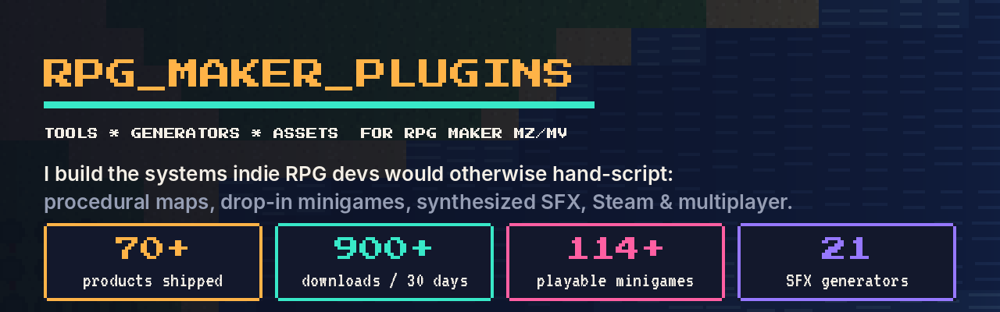
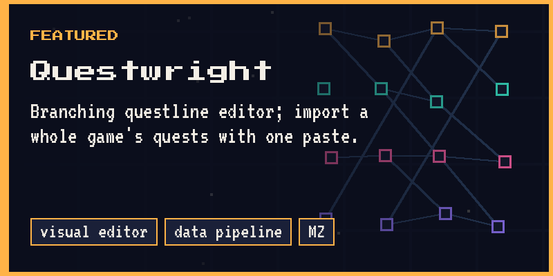
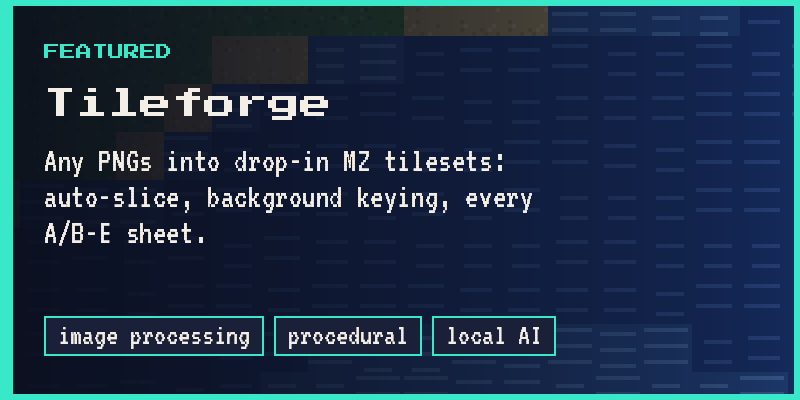
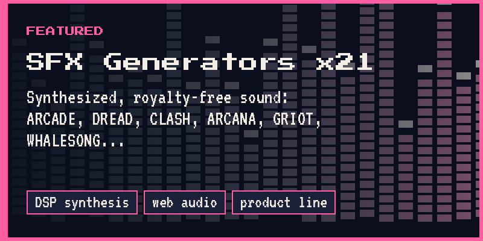
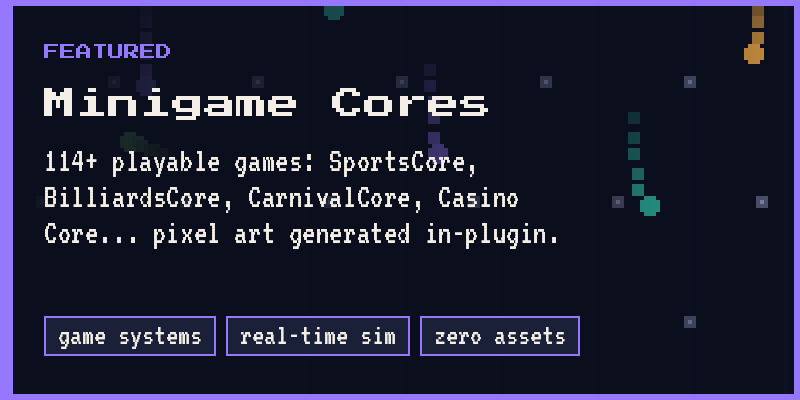
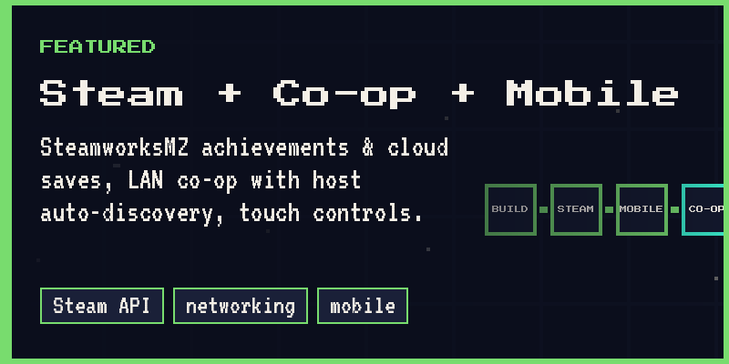
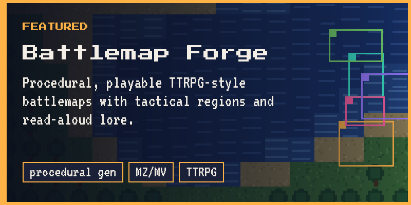
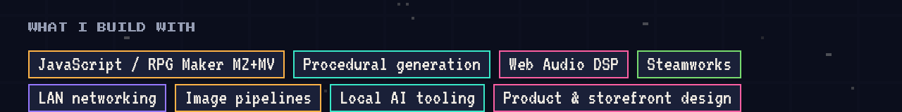

<!-- Profile README. Lives in the repo named exactly like your GitHub username (YOUR-USERNAME/YOUR-USERNAME). -->
<!-- Replace YOUR-USERNAME, YOUR-NAME, and the video URL. Images live in assets/ in this same repo. -->

  

  <a href="https://rpg-maker-plugins.itch.io/"><b>itch.io storefront</b></a> &nbsp;·&nbsp;
  <a href="YOUR-VIDEO-URL"><b>2-minute showreel</b></a> &nbsp;·&nbsp;
  <a href="https://www.linkedin.com/in/YOUR-LINKEDIN/"><b>LinkedIn</b></a> &nbsp;·&nbsp;
  <a href="https://bsky.app/profile/rpgmakerplugins.bsky.social">Bluesky</a> &nbsp;·&nbsp;
  <a href="https://mastodon.social/@rpg_maker_plugins">Mastodon</a>

## Hi, I'm YOUR-NAME

I design and ship tools for RPG Maker developers. Over the last year that has meant **70+ products** — plugins, procedural generators and asset packs — sold through a single storefront that now does **900+ downloads a month**.

I'm a big-picture builder: I'd rather write the system that generates a thousand maps than place one tile. Most of what's below replaces something an indie dev would otherwise hand-script for weeks.

## Featured work

<table>
  <tr>
    <td width="50%"></td>
    <td width="50%"></td>
  </tr>
  <tr>
    <td></td>
    <td></td>
  </tr>
  <tr>
    <td></td>
    <td></td>
  </tr>
</table>

| Area | What I built | Why it's hard |
|---|---|---|
| **World building** | Tileforge, Tile Animation Forge, Battlemap Forge, Dynamic Building Interiors, Questwright, MZ Companion | Image slicing & keying pipelines, autotile generation, procedural layout with tactical regions, a visual quest editor with one-paste import |
| **Minigames** | 13 "core" plugins, 114+ playable games (SportsCore, BilliardsCore, CarnivalCore, Casino Core, Clockwork Capers, Dino, Holiday Pack…) | Real-time sim loops inside an RPG engine, rosters/seasons/playoffs state, pixel art generated in-plugin so users need zero image assets |
| **Sound** | 21 synthesized SFX/BGM generators (ARCADE, DREAD, CLASH, ARCANA, GRIOT, WHALESONG…) | Web Audio DSP: procedural, loopable, royalty-free sound with no sample library |
| **Shipping** | SteamworksMZ, Multiplayer (LAN co-op), Mobile Touch Adapter, Social Share photo mode | Steam API bridging that degrades gracefully without Steam, host auto-discovery with no server, touch input mapping |
| **Economy & systems** | Cash Shop Core, Gacha System, Loot Ledger, Master Merchant Shops, Easy Trait-Tree, SimpleMerge, Evolving Enemy Powerscaling | Weighted tables, pity math, rule-based merchants, sub-linear scaling curves |
| **Art** | 124+ front-view battlers across Yokai, Norse, Cryptid, Medieval Legions, Monster Girls; Gloamwound & Ashen Reach bundles | Consistent style across every pack so a game never looks stitched together |

## Open source

The paid plugins are closed-source, but these are public and MIT-licensed so you can see how I write code:

| Repo | What it is |
|---|---|
| [`loot-ledger-mz`](https://github.com/YOUR-USERNAME/loot-ledger-mz) | Weighted loot tables, nested tables and rarity tiers for MZ. Free on itch too. |
| [`playtest-grimoire-mz`](https://github.com/YOUR-USERNAME/playtest-grimoire-mz) | One-hotkey dev toolbar: teleport, gold, switches, variables. |
| [`mz-plugin-template`](https://github.com/YOUR-USERNAME/mz-plugin-template) | The starter I build every plugin from: parameter schema, plugin commands, build script, test project. |
| [`plugin-docs`](https://github.com/YOUR-USERNAME/plugin-docs) | Setup guides and manuals for every product on the storefront. |

## By the numbers

- **70+** products on one storefront · **900+** downloads in the last 30 days
- **114+** playable minigames · **21** SFX generators · **124+** hand-drawn battlers
- Every tool ships for **RPG Maker MZ**, most also for **MV**; everything is written to be VisuStella-friendly

## Let's talk

Open to plugin commissions, tooling contracts and engine-integration work.
**Email:** YOUR-EMAIL · **LinkedIn:** [YOUR-NAME](https://www.linkedin.com/in/YOUR-LINKEDIN/) · **Store:** [rpg-maker-plugins.itch.io](https://rpg-maker-plugins.itch.io/)
